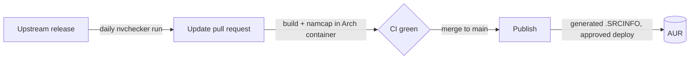

<div align="center">

# aur-packages

The PKGBUILDs behind shbernal's AUR packages, built, checked and published from one repo.

[![CI][ci-badge]][ci] [![Publish][publish-badge]][publish] [![License][license-badge]][license]

---

[Packages](#packages) • [Install](#install) • [How it works](#how-it-works)

---

</div>

## Packages

| Package | What it is | Upstream |
| --- | --- | --- |
| [amass][aur-amass] | In-depth attack surface mapping and asset discovery | [owasp-amass/amass](https://github.com/owasp-amass/amass) |
| [mantisbt-cli][aur-mantisbt-cli] | Command line client for the MantisBT REST API, built from source | [overworks/mantisbt-cli](https://github.com/overworks/mantisbt-cli) |
| [mantisbt-cli-bin][aur-mantisbt-cli-bin] | The same, from the upstream release binaries (x86_64, aarch64) | [overworks/mantisbt-cli](https://github.com/overworks/mantisbt-cli) |
| [mantisbt-cli-git][aur-mantisbt-cli-git] | The same, from the latest commit | [overworks/mantisbt-cli](https://github.com/overworks/mantisbt-cli) |
| [och][aur-och] | Small helper for OpenClaw TUI session management | [shbernal/och](https://github.com/shbernal/och) |
| [shift-editor-bin][aur-shift-editor-bin] | Cross-platform font editor built in Rust and TypeScript | [shift-editor/shift](https://github.com/shift-editor/shift) |

## Install

Install from the AUR with any AUR helper, for example:

```bash
yay -S och
```

Report packaging problems as issues here. Bugs in the software itself belong upstream.

## How it works



- Each directory under `packages/` is one AUR package, with its full AUR history.
- `.SRCINFO` is not tracked here. It is generated on publish, so it always matches the PKGBUILD.
- Every pull request builds the changed packages in `archlinux:base-devel` and runs namcap on the PKGBUILD and the built package.
- A daily job checks upstream releases and opens one pull request per release, with the version and checksums already bumped.
- Merging to `main` pushes each changed package to its AUR repo, after a manual approval of the `aur` deployment.

[ci]: https://github.com/shbernal/aur-packages/actions/workflows/ci.yml
[ci-badge]: https://img.shields.io/github/actions/workflow/status/shbernal/aur-packages/ci.yml?branch=main&style=for-the-badge&label=ci&logo=githubactions&logoColor=white&color=1793d1
[publish]: https://github.com/shbernal/aur-packages/actions/workflows/publish.yml
[publish-badge]: https://img.shields.io/github/actions/workflow/status/shbernal/aur-packages/publish.yml?branch=main&style=for-the-badge&label=publish&logo=archlinux&logoColor=white&color=1793d1
[license]: LICENSE
[license-badge]: https://img.shields.io/github/license/shbernal/aur-packages?style=for-the-badge&color=4d5a6b
[aur-amass]: https://aur.archlinux.org/packages/amass
[aur-mantisbt-cli]: https://aur.archlinux.org/packages/mantisbt-cli
[aur-mantisbt-cli-bin]: https://aur.archlinux.org/packages/mantisbt-cli-bin
[aur-mantisbt-cli-git]: https://aur.archlinux.org/packages/mantisbt-cli-git
[aur-och]: https://aur.archlinux.org/packages/och
[aur-shift-editor-bin]: https://aur.archlinux.org/packages/shift-editor-bin
