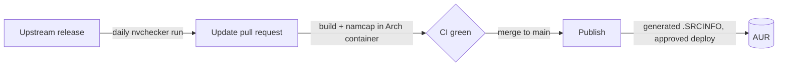

<div align="center">

# aur-packages

The PKGBUILDs behind shbernal's AUR packages, built, checked and published from one repo.

[![CI][ci-badge]][ci] [![Publish][publish-badge]][publish] [![License][license-badge]][license]

---

[Install](#install) • [Contributing](#contributing) • [How it works](#how-it-works)

---

</div>

## Install

The packages are listed [on the AUR](https://aur.archlinux.org/packages?SeB=m&K=shbernal). Install them with any AUR helper, for example:

```bash
yay -S och
```

Report packaging problems as issues here. Bugs in the software itself belong upstream.

## Contributing

AUR registration is closed for now, so if you can't upload a package yourself, submit your PKGBUILD as a pull request and I can publish it for you. [CONTRIBUTING.md](CONTRIBUTING.md) has what the pull request needs.

## How it works



- Each directory under `packages/` is one AUR package, with its full AUR history.
- `.SRCINFO` is not tracked here. It is generated on publish, so it always matches the PKGBUILD.
- Every pull request builds the changed packages in `archlinux:base-devel` and runs namcap on the PKGBUILD and the built package.
- A daily job checks upstream releases and opens one pull request per release, with the version and checksums already bumped.
- Merging to `main` pushes each changed package to its AUR repo, after a manual approval of the `aur` deployment.

[ci]: https://github.com/shbernal/aur-packages/actions/workflows/ci.yml
[ci-badge]: https://img.shields.io/github/actions/workflow/status/shbernal/aur-packages/ci.yml?branch=main&style=for-the-badge&label=ci&logo=githubactions&logoColor=white&color=1793d1
[publish]: https://github.com/shbernal/aur-packages/actions/workflows/publish.yml
[publish-badge]: https://img.shields.io/github/actions/workflow/status/shbernal/aur-packages/publish.yml?branch=main&style=for-the-badge&label=publish&logo=archlinux&logoColor=white&color=1793d1
[license]: LICENSE
[license-badge]: https://img.shields.io/github/license/shbernal/aur-packages?style=for-the-badge&color=4d5a6b
